<!-- ═══════════════════════ DEEP-SPACE HEADER ═══════════════════════ -->
<!-- Venom-type render = twin planetary horizons rising out of the void -->

<!-- ═══════════════ TRANSMISSION: ANIMATED TYPING INTRO ═══════════════ -->

  

 

<!-- ═══════════════════ ORBITAL COMMS BADGES ═══════════════════ -->

  
  &nbsp;
  
  &nbsp;
  
  &nbsp;
  

 

## 🛸 Who Am I? | من أنا

  

## 🚀 Currently Building & Learning

  

## 🛰️ Tech Stack

  

## 🪐 Featured Projects

<table align="center" width="100%">
  <tr>
    <td width="50%" valign="top">
      <h3>🤖 <a href="https://github.com/zinmeir/CloudAide-full-build">FYP-CloudAide</a></h3>
      
An autonomous AI Cloud Support Engineer that self-heals AWS infrastructure via a 4-phase RAG pipeline (Bi-encoders → FAISS → Cross-encoders → LLaMA 3.1).

      
      
      
      
    </td>
    <td width="50%" valign="top">
      <h3>📋 <a href="https://github.com/zinmeir/DevSprint">DevSprint</a></h3>
      
A real-time, LLM-powered Agile planning suite. Features automated sprint generation via generative AI and live state synchronization through AWS API Gateway WebSockets.

      
      
      
      
    </td>
  </tr>
  <tr>
    <td width="50%" valign="top">
      <h3>🔍 <a href="https://github.com/zinmeir/CodeReviewX">CodeReviewX</a></h3>
      
An LLM-powered GitHub bot for hybrid (static + semantic) code reviews and automated inline PR comments via CI/CD.

      
      
      
      
    </td>
    <td width="50%" valign="top">
      <h3>🌎 <a href="https://github.com/zinmeir/RelocAitor">RelocAitor</a></h3>
      
An AI-powered relocation advisor featuring a WebGL-rendered 3D interactive world map that scores global destinations based on user preferences.

      
      
      
    </td>
  </tr>
  <tr>
    <td width="50%" valign="top">
      <h3>📄 <a href="https://github.com/zinmeir/ResumeLens">ResumeLens</a></h3>
      
A transformer-based NLP engine for semantic resume matching, similarity scoring, and skill gap extraction.

      
      
      
    </td>
    <td width="50%" valign="top">
      <h3>☁️ <a href="https://github.com/zinmeir/CloudFixDB">CloudFixDB</a></h3>
      
Custom relational database for tracking cloud resources, incidents, alerts & automated remediation actions.

      
      
    </td>
  </tr>
  <tr>
    <td width="50%" valign="top">
      <h3>📊 <a href="https://github.com/zinmeir/InsightForge">InsightForge</a></h3>
      
A high-throughput, SRE-grade observability engine featuring distributed log ingestion, indexed querying, dynamic dashboards, and a metrics-driven alerting pipeline.

      
      
      
      
    </td>
    <td width="50%" valign="top">
      <h3>🪤 <a href="https://github.com/zinmeir/NetherSiphon">IntruderTrap</a></h3>
      
Enterprise-grade cyber deception and SIEM pipeline that uses Linux honeypots to intercept SSH attacks and collect attacker telemetry, credentials, and post-compromise activity.

      
      
      
    </td>
  </tr>
</table>

<!-- ═══════════════ TELEMETRY: live stats, regenerated daily by .github/workflows/stats-card.yml ═══════════════ -->

  

## 🔭 Research Publications

  

<!-- ☄️ Activity — a comet sweeping the contribution grid + streak stats, regenerated daily by .github/workflows/stats-card.yml -->

  

## 🌠 Certifications

<b>🎓 Click to expand full certifications list</b>

 

**🤖 AI, Data & Machine Learning**

<table>
  <tr>
    <td align="center" width="110">
       
      IBM AI Engineering Professional
    </td>
    <td align="center" width="110">
       
      DeepLearning.AI ML Specialization by Andrew Ng & Stanford Online
    </td>
    <td align="center" width="110">
       
      Google Advanced Data Analytics
    </td>
    <td align="center" width="110">
       
      Vertex AI Advanced GenAI
    </td>
    <td align="center" width="110">
       
      Responsible AI & Constitutional AI by Anthropic
    </td>
    <td align="center" width="110">
       
      Introduction to Model Context Protocol (MCP) by Anthropic
    </td>
  </tr>
</table>

 

**☁️ Cloud & Cybersecurity**

<table>
  <tr>
    <td align="center" width="110">
       
      AWS Cloud Practitioner Essentials
    </td>
    <td align="center" width="110">
       
      Google Cloud GenAI Fundamentals
    </td>
    <td align="center" width="110">
       
      Microsoft Azure AI Fundamentals AI-900
    </td>
    <td align="center" width="110">
       
      Google Cybersecurity Professional
    </td>
    <td align="center" width="110">
       
      Intro to Networks (CCNA)
    </td>
  </tr>
</table>

 

**🏆 Memberships**

<table>
  <tr>
    <td align="center" width="110">
       
      Young Member @The New York Academy of Sciences
    </td>
    <td align="center" width="110">
       
      Organizer @GDG Peshawar
    </td>
    <td align="center" width="110">
       
      Chapter Lead @The AI Collective, Islamabad
    </td>
  </tr>
</table>

## 📡 Let's Connect

&nbsp;

&nbsp;

 

<i>💡 Bridging the gap between AI/ML research and full-stack deployment. Open to engineering roles, enterprise contracts, and R&D partnerships.</i> 
<i>📍 Operating globally via a remote-first workflow.</i>

 

<!-- ═══════════════════════ FOOTER: EVENT HORIZON ═══════════════════════ -->

